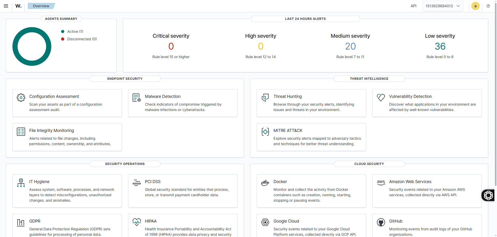
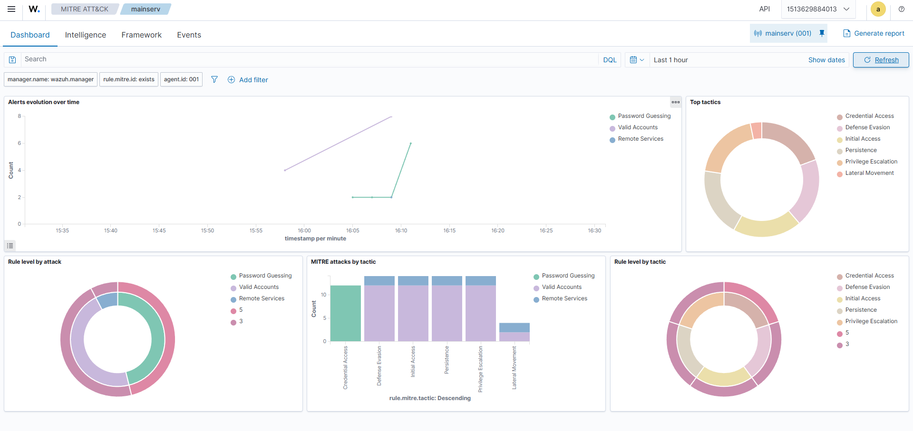
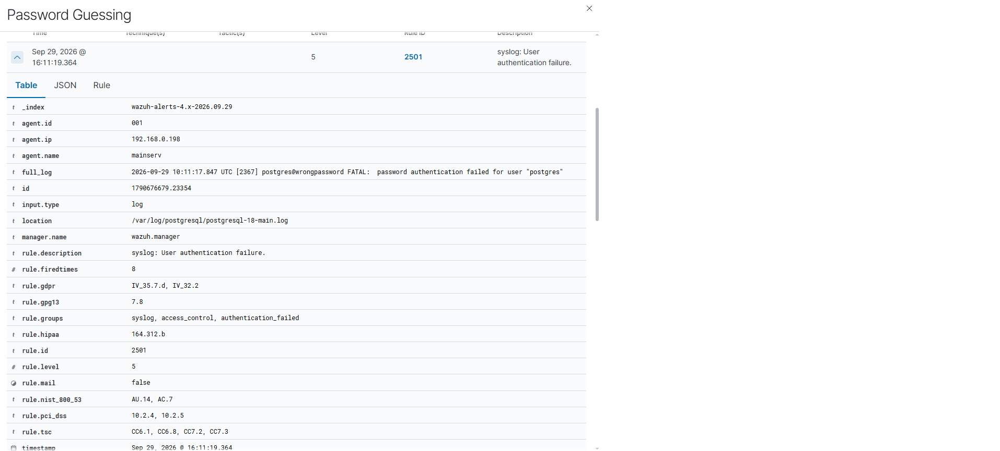

# Wazuh SIEM — Air-Gapped Deployment

## About the Project

This project covers the deployment of a centralized Wazuh SIEM system in a closed (air-gapped) environment running on Ubuntu Server 26.04 LTS.

## Architecture

- **Server-Security** (Ubuntu 26.04): Wazuh Indexer + Manager + Dashboard (Docker)
- **Server-Prod / mainserv** (Ubuntu): PostgreSQL + Wazuh Agent
- **Kali Linux**: Security and penetration testing

Network: VirtualBox configured with Bridged + Host-only adapters (isolated network segment).

## Tech Stack

- Wazuh 4.14.7 (Indexer, Manager, Dashboard)
- Docker & Docker Compose
- OpenSearch, Filebeat
- Ubuntu Server 26.04 LTS, Kali Linux
- LVM, Bash, SSL/TLS

## Key Implementations

- Deployed Wazuh SIEM (all three components) using Docker.
- Prepared the host machine: expanded LVM from 28 GB to 50 GB and configured `vm.max_map_count=262144`.
- Generated custom SSL/TLS certificates for secure cluster communication.
- Added 4 volume mounts to prevent uncontrolled writable layer growth in Docker containers.
- Disabled the Vulnerability Detector module (as it requires an active internet connection to update databases).
- Enrolled the Wazuh Agent on the PostgreSQL production server.
- Configured advanced log monitoring for PostgreSQL, `auth.log`, and `syslog`.
- Validated detection capabilities against SSH brute-force and failed `sudo` attempts, with full MITRE ATT&CK mapping.

## Troubleshooting & Solutions

| Issue | Solution |
|---|---|
| Broken `dpkg` manager on Ubuntu 26.04 | Switched from native package installation to Docker |
| `No space left on device` error | Expanded LVM storage pool up to 50 GB |
| `ClusterManagerNotDiscoveredException` | Caused by a completely full disk; resolved via storage cleanup |
| Manager writable layer grew to 8.63 GB | Set up 4 dedicated persistent volume mounts |
| `wazuh_queue` size swelled to 10.82 GB | Disabled the offline-incompatible Vulnerability Detector |

## Deployment

### Prerequisites

- Ubuntu Server 26.04 LTS (or similar)
- Docker & Docker Compose V2
- Kernel parameter `vm.max_map_count=262144`
- Minimum 50 GB disk space (LVM recommended)

### Quick Start

```bash
# Clone the repository
git clone https://github.com/Sam-DevSec/wazuh-siem-homelab.git
cd wazuh-siem-homelab/single-node

# Set kernel parameter
sudo sysctl -w vm.max_map_count=262144
echo "vm.max_map_count=262144" | sudo tee -a /etc/sysctl.conf

# Generate SSL certificates
sudo docker compose -f generate-indexer-certs.yml run --rm generator

# Start the stack
sudo docker compose up -d
```

### Access

- **Wazuh Dashboard:** `https://<server-ip>`
- **Default credentials:** see `.env` file

### Agent Installation

On the monitored host:

```bash
curl -so wazuh-agent.deb https://packages.wazuh.com/4.x/apt/pool/main/w/wazuh-agent/wazuh-agent_4.14.7-1_amd64.deb
sudo WAZUH_MANAGER='<manager-ip>' dpkg -i ./wazuh-agent.deb
sudo systemctl daemon-reload
sudo systemctl enable --now wazuh-agent
```

### Configuration Notes

- Vulnerability Detector is **disabled** by design (air-gapped environment, no internet access for feeds).
- Extra volume mounts added to `wazuh.manager` to prevent writable layer growth.
- Custom `localfile` blocks in the agent config for PostgreSQL, auth, and syslog monitoring.

## Screenshots

### Wazuh Dashboard — Overview



*Centralized monitoring dashboard with agent summary and alert severity breakdown across the last 24 hours.*

### MITRE ATT&CK Dashboard



*Automatic classification of security events by MITRE ATT&CK tactics and techniques — Credential Access, Defense Evasion, Initial Access, Persistence, Privilege Escalation, and Lateral Movement.*

### Alert Detail — Password Guessing Detection



*Detailed view of a single alert: PostgreSQL authentication failure mapped to MITRE T1110.001 (Password Guessing), with compliance checks for PCI DSS, HIPAA, NIST 800-53, GDPR, and TSC.*

## Author

**Sam-Dev.Sec** — [github.com/Sam-DevSec](https://github.com/Sam-DevSec)